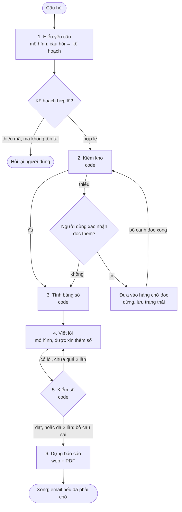

# Agent tạo báo cáo theo yêu cầu

> Bản đặc tả, chốt ngày 21/10/2026. Chi tiết hóa mục 7 (AI Analyst Agent) của [architecture.md](architecture.md) cho phạm vi Project 3.

## 1. Mục tiêu

Người dùng gõ một câu tiếng Việt tự do, ví dụ "so sánh KQKD quý 3/2026 của VCB và TCB" hoặc "đánh giá kết quả quý 3 của FPT so với cùng kỳ". Agent hiểu yêu cầu, lập kế hoạch, tự đi lấy BCTC còn thiếu, tính số, viết nhận định và trả về một báo cáo hoàn chỉnh: lời văn, bảng, biểu đồ, nguồn của từng số. Báo cáo xem trên web và tải được PDF.

So với mô tả đề tài đăng ký ban đầu, có bốn điểm khác:

- **Thu thập không làm lúc người dùng hỏi.** Hệ thống quét và đọc sẵn mọi BCTC của các mã đang theo dõi. Agent chỉ đi lấy thêm khi người dùng hỏi kỳ cũ hơn kho hoặc mã chưa theo dõi.
- **Mọi con số đã được kiểm chứng.** Số đi qua ràng buộc kế toán và đối chiếu giữa các kỳ; mỗi số kèm tài liệu, trang, dòng.
- **Lời văn được kiểm lại bằng code.** Mọi con số và từ chỉ chiều mô hình viết ra đều được so lại với bảng số trước khi người dùng thấy.
- **Là dịch vụ thông tin, không phải khuyến nghị đầu tư.** Không có câu "nên mua/bán", không giá mục tiêu.

## 2. Phạm vi

Có trong Project 3:

- Ba loại yêu cầu:
  - **so nhiều mã cùng kỳ**;
  - **một mã so với cùng kỳ năm trước**;
  - **vị trí của một mã trong nhóm**.
- Kỳ: quý, bán niên, cả năm. Cách tính: riêng quý, hoặc lũy kế từ đầu năm.
- Nhóm so sánh:
  - ngân hàng so với các ngân hàng đang theo dõi;
  - công ty chứng khoán so với nhau;
  - doanh nghiệp khác so với "các doanh nghiệp VN30".
  - Mã ngành thêm khi mở rộng VN100.
- Không giới hạn số mã trong một yêu cầu. Khi có nhiều mã, báo cáo chuyển sang bảng xếp hạng kèm vài câu nêu điểm nổi bật.

Chưa làm trong Project 3:

- xu hướng nhiều quý;
- ROE, NIM (cần số bình quân nhiều kỳ);
- đọc thuyết minh để tìm nguyên nhân (mới dùng công văn giải trình);
- hỏi đáp nhiều lượt;
- link chia sẻ công khai.

## 3. Đồ thị các bước

Agent là một đồ thị trạng thái LangGraph. Trạng thái của mỗi báo cáo được lưu vào PostgreSQL sau từng bước, nên báo cáo dừng chờ được (chờ người dùng xác nhận, chờ đọc BCTC) rồi chạy tiếp đúng chỗ, kể cả khi dịch vụ khởi động lại.



Phân công giữa mô hình và code:

| Bước | Mô hình | Code |
|---|---|---|
| 1. Hiểu yêu cầu | đổi câu hỏi thành kế hoạch | kiểm kế hoạch, điền kỳ "gần nhất" |
| 2. Kiểm kho | | toàn bộ |
| 3. Tính bảng số | | toàn bộ |
| 4. Viết lời | chọn ý, viết câu, xin thêm số hoặc nguyên nhân | chạy công cụ mô hình xin |
| 5. Kiểm số | | toàn bộ |
| 6. Dựng báo cáo | | toàn bộ |

Mô hình chỉ nhận chữ và trả JSON theo khuôn, gọi qua lớp gọi mô hình hiện có (`services/llm.py`). Vì vậy:

- đổi Claude ↔ OpenAI và chuyển nhà khi lỗi giống các bước đọc BCTC;
- chi phí ghi theo bước (`plan_request`, `write_report`).

Mô hình không dùng cách gọi công cụ riêng của từng hãng. Khi cần thêm dữ liệu, nó trả JSON dạng "cần thêm", code chạy công cụ rồi gửi lại.

## 4. Kế hoạch

Mô hình trả kế hoạch theo khuôn sau:

| Trường | Giá trị |
|---|---|
| `kind` | `compare` (so nhiều mã) / `yoy` (một mã so cùng kỳ) / `rank` (vị trí trong nhóm) |
| `tickers` | danh sách mã như người dùng viết |
| `year`, `period` | năm; `Q1`–`Q4`, `H1`, `FY`, hoặc `latest` |
| `basis` | `quarter` (riêng quý) / `ytd` (lũy kế từ đầu năm) |
| `metrics` | chỉ tiêu người dùng nhắc, chọn trong danh mục; trống thì dùng bộ chỉ tiêu của thẻ KQKD |
| `unclear` | điều mô hình không chắc |
| `advice_request` | câu hỏi có xin khuyến nghị mua bán không |

Code kiểm:

- **Mã:** mã phải có trong bảng công ty, hoặc tìm được trên Vietstock như đường yêu cầu mã ngoài danh sách. Không có mã nào, hoặc mã không tồn tại, thì hỏi lại một câu.
- **Kỳ:** `latest` được điền bằng kỳ mới nhất mà mọi mã đều có BCTC đã kiểm chứng. Người dùng không nói kỳ thì lấy kỳ gần nhất và ghi rõ trong báo cáo.
- **Xin khuyến nghị:** vẫn làm báo cáo thông tin, kèm một câu nói rõ hệ thống không đưa khuyến nghị.

Danh mục chỉ tiêu:

| Loại công ty | Chỉ tiêu |
|---|---|
| Doanh nghiệp | doanh thu thuần, lợi nhuận gộp, LNTT, LNST, LNST cổ đông công ty mẹ, chi phí bán hàng, chi phí quản lý, doanh thu và chi phí tài chính; biên lợi nhuận gộp, biên lợi nhuận ròng |
| Ngân hàng | thu nhập lãi thuần, tổng thu nhập hoạt động, chi phí hoạt động, chi phí dự phòng, LNTT, LNST cổ đông ngân hàng mẹ; chi phí hoạt động trên tổng thu nhập hoạt động |
| Công ty chứng khoán | cộng doanh thu hoạt động, cộng chi phí hoạt động, LNTT, LNST phân bổ cho chủ sở hữu |

Mã chỉ tiêu lấy từ `services/metrics/canonical.py`. Tỷ lệ do code tính.

## 5. Công cụ

Các công cụ là hàm Python bọc code đã có. Số trả về luôn kèm nguồn (tài liệu, trang, dòng, chữ như in).

| Công cụ | Làm gì | Ai dùng |
|---|---|---|
| `availability` | (mã, kỳ) đã có BCTC kiểm chứng chưa. BCTC bán niên/năm chưa có thì dùng lũy kế ở BCTC quý 2/quý 4; kỳ chưa có BCTC thì đề nghị đọc thêm (để có cả số cùng kỳ), không lấy cột cùng kỳ của năm sau thay vào. Chỉ dùng BCTC công khai, không dùng file người dùng tải lên riêng | bước 2 |
| `request_reading` | đưa (mã, kỳ) vào hàng chờ đọc (`services/ondemand.py`) | sau khi người dùng xác nhận |
| `metric_values` | giá trị chỉ tiêu theo mã, kỳ, cách tính, kỳ này và cùng kỳ (`Facts` của thẻ) | bước 3; mô hình xin thêm ở bước 4 |
| `peer_group` | danh sách mã cùng nhóm | bước 3 |
| `reasons` | nguyên nhân trong công văn giải trình kèm kết quả đối chiếu: khớp / chỉ khớp chiều / không kiểm được | mô hình xin ở bước 4 |
| `card_flags` | các cờ cảnh báo của thẻ KQKD | bước 3 |

## 6. Bảng số

Bảng số là danh sách dòng có mã `S1`, `S2`, … Mỗi dòng là một sự kiện đã tính sẵn, kèm nguồn. Ví dụ:

> S12: LNST của cổ đông ngân hàng mẹ, TCB, quý 3/2026 = 7.943 tỷ; cùng kỳ 6.419 tỷ; thay đổi +23,7%

Code tính sẵn các phép so sánh hay dùng để mô hình không phải tính:

- thay đổi so với cùng kỳ, theo % và theo số tiền;
- chênh lệch tăng trưởng giữa hai mã, theo điểm %;
- thứ hạng trong nhóm, cao nhất và thấp nhất nhóm, trung vị nhóm;
- tỷ trọng (ví dụ lợi nhuận khác chiếm bao nhiêu phần LNTT);
- số lần ("gấp 2,3 lần").

Dòng tỷ trọng (ví dụ lợi nhuận khác trên LNTT) chưa làm trong P3; cờ "lợi nhuận phần lớn ngoài hoạt động chính" của thẻ đã nêu tỷ trọng đó.

Quy tắc hiển thị:

- Lợi nhuận âm ở kỳ này hoặc cùng kỳ thì không ghi %, mà tả bằng lời như thẻ KQKD.
- Số chưa kiểm chứng (ô "cần xem lại", BCTC chưa đạt) không vào bảng số.

## 7. Viết lời

Mô hình nhận kế hoạch và bảng số, trả về các mục. Mỗi mục có tiêu đề và các câu; mỗi câu ghi mã các dòng số nó dùng:

```json
{"sections": [{"heading": "Lợi nhuận", "sentences": [
  {"text": "LNST của TCB tăng 23,7%, nhanh hơn VCB 8,1 điểm %.", "uses": ["S12", "S31"]}]}],
 "need": []}
```

`need` là danh sách thứ mô hình muốn xin thêm (một chỉ tiêu, nguyên nhân của một mã). Code chạy công cụ, thêm dòng vào bảng số rồi gọi lại; tối đa 3 lần.

Lời dặn mô hình:

- chỉ dùng số trong bảng;
- không khuyến nghị mua bán, không dự báo giá;
- nguyên nhân "không kiểm được" thì viết "theo công ty";
- tiếng Việt đời thường, thuật ngữ BCTC giữ nguyên.

## 8. Bộ kiểm tra số

Bộ kiểm tra là code, không gọi mô hình, chạy trên từng câu:

1. **Trích con số.** Đọc mọi con số theo kiểu viết Việt Nam: `1.234,5 tỷ`, `23,7%`, `8,1 điểm %`, `gấp 2,3 lần`, `gấp đôi`. Năm, quý, ngày tháng được nhận ra và bỏ qua.
2. **So với bảng số.** Mỗi số phải khớp một giá trị trong các dòng câu đã ghi (`uses`).
   - Sai số theo chữ số cuối như in, và 0,1% giá trị (cùng quy tắc với phần đối chiếu công văn).
   - "Khoảng/gần": lệch tối đa 5%.
   - "Hơn/trên": số thật phải lớn hơn; "dưới": số thật phải nhỏ hơn.
3. **Kiểm từ chỉ chiều.** "Tăng/giảm", "cải thiện/suy giảm", "lãi/lỗ", "nhanh hơn/chậm hơn", "cao hơn/thấp hơn", "cao nhất/thấp nhất" phải khớp dấu hoặc thứ tự trong bảng. Chi phí tính theo độ lớn.
   - Số đứng sau "lãi/lỗ" phải đúng dấu: số tiền ngay sau "lỗ" chỉ khớp khoản lỗ trong bảng, ngay sau "lãi" chỉ khớp khoản lãi.
   - Thứ hạng "thứ N/M", "thứ N trong M", "đứng thứ N" phải đúng: N là vị trí của mã trong dòng xếp hạng, M là số mã của dòng đó.
4. **Các lỗi khác:**
   - số không có trong dòng nào câu đã ghi ("số không có nguồn");
   - câu dẫn mã dòng không tồn tại;
   - câu nhắc mã chứng khoán ngoài kế hoạch;
   - ngôn ngữ khuyến nghị ("nên mua", "nên bán", "giá mục tiêu", "khuyến nghị", "cơ hội đầu tư", …).

Khi có lỗi, câu sai được gửi lại mô hình kèm danh sách lỗi để viết lại, tối đa 2 lần. Vẫn sai thì bỏ câu đó. Câu bị bỏ chỉ quản trị viên thấy.

Nhật ký lưu số câu và số lỗi theo loại ở lần viết đầu, sau mỗi lần viết lại, và số câu bị bỏ.

## 9. Lưu trữ, trang web, PDF

**Bảng `reports`** (migration mới), gồm các cột:

- người tạo, câu hỏi, kế hoạch, bảng số, bài viết cuối, nhật ký kiểm số, chi phí;
- trạng thái: `planning`, `needs_clarification`, `awaiting_confirmation`, `waiting_data`, `writing`, `done`, `failed`;
- các BCTC nguồn kèm phiên bản kết quả trích xuất;
- thời điểm tạo và xong.

Trạng thái của đồ thị lưu bằng gói lưu trạng thái Postgres chính thức của LangGraph. Mỗi báo cáo là một luồng (`thread_id` = id báo cáo).

**Dùng lại.** Cùng người dùng, cùng kế hoạch và các BCTC nguồn không đổi phiên bản thì trả báo cáo cũ, không tính hạn mức.

**Ai chạy đồ thị:**

- Gửi câu hỏi: web chạy đồ thị ở nền. Trang báo cáo hỏi trạng thái vài giây một lần.
- Báo cáo `waiting_data`: bộ canh chạy tiếp sau khi BCTC cần đọc đã xong, rồi gửi email kèm link.

**Trang web:**

- `/bao-cao`: ô gõ yêu cầu, vài câu mẫu, danh sách báo cáo của tôi.
- `/bao-cao/{id}`: gồm
  - kế hoạch agent hiểu được;
  - lời văn theo mục, mỗi số là liên kết tới dòng bảng số và trang BCTC gốc;
  - bảng số, biểu đồ, nguồn;
  - nhãn "Nội dung do AI viết từ số liệu đã kiểm chứng; không phải khuyến nghị đầu tư".
- Nút "Đọc thêm BCTC" (khi chờ xác nhận): ghi rõ BCTC nào, chi phí ước tính, hạn mức còn lại.
- Biểu đồ: hình SVG do code vẽ, dùng chung cho web và PDF:
  - cột so sánh giữa các mã;
  - cột kỳ này và cùng kỳ;
  - thanh xếp hạng trong nhóm.

**PDF.** `/bao-cao/{id}/pdf` dựng từ chính HTML của trang bằng WeasyPrint. Phông chữ tiếng Việt cài trong ảnh Docker.

**Quyền xem.** Chỉ người tạo và quản trị viên xem được. Chia sẻ bằng PDF.

## 10. Chi phí và lỗi

- **Chi phí.** Ước khoảng 0,01–0,03 USD mỗi báo cáo với Haiku 5.5; đo thật ở mục 11.
- **Hạn mức.** 20 báo cáo mỗi người mỗi ngày; báo cáo dùng lại không tính.
- **Trần chi phí.** Tiền gọi mô hình cho báo cáo tính chung vào trần chi phí tháng của phần đọc theo yêu cầu. Trang chi phí của quản trị thêm hai bước `plan_request`, `write_report`.
- **Đọc thêm BCTC** đi đường yêu cầu theo mã sẵn có, tính hạn mức ngày và trần tháng như hiện nay.
- **Nhà cung cấp lỗi hoặc hết tiền:** tự chuyển sang nhà kia.
- **Không tìm được BCTC cần đọc:** báo cáo vẫn viết với phần có, ghi rõ phần thiếu và lý do.
- **Lỗi khác:** trạng thái `failed` kèm lý do, quản trị viên nhận email.

## 11. Đo lường

**Bộ câu yêu cầu** `Code/eval/data/agent_requests.jsonl` (nằm trong `Code/` để container thấy), khoảng 50 câu, mỗi câu kèm kế hoạch đúng. Các câu phủ:

- ba loại yêu cầu;
- nhiều cách nói: trang trọng, nói tắt, không dấu, sai chính tả nhẹ, kỳ nói bằng chữ;
- các trường hợp khó: thiếu mã, mã không tồn tại, kỳ ngoài kho, xin khuyến nghị.

Người dùng thêm vài câu theo cách mình hay hỏi.

**Chương trình đo** `eval/agent.py`:

1. **Hiểu yêu cầu:** tỷ lệ câu có kế hoạch đúng hoàn toàn; tỷ lệ đúng theo từng trường.
2. **Độ trung thực:**
   - Trên mọi câu sinh ra cho cả bộ: tỷ lệ câu có lỗi ở lần viết đầu (theo loại), sau khi viết lại, số câu bị bỏ.
   - Cấy lỗi vào các câu đã đạt (đổi số, đảo tăng/giảm, đổi thứ hạng, thêm từ khuyến nghị) để đo tỷ lệ bộ kiểm tra bắt được. Phần này không gọi mô hình.
3. **Lợi ích thực:** tỷ lệ báo cáo hoàn thành không cần người can thiệp; thời gian và chi phí mỗi báo cáo.
4. **So nhà cung cấp:** Haiku 5.5 và gpt-5.4-mini chạy cùng bộ câu, cùng bảng số, cùng điều kiện.

Kết quả gọi mô hình được lưu để chấm lại miễn phí. Cả bộ ước 2 USD (50 câu × 2 nhà): thử 5 câu trước, xin phép trước khi chạy hết.

## 12. Kiểm thử tự động

Không gọi mô hình:

- **Bộ kiểm tra số:** đọc số kiểu Việt Nam, sai số làm tròn, khoảng/hơn/dưới, từ chỉ chiều, từ khuyến nghị, số không có nguồn.
- **Kế hoạch:** kiểm kế hoạch, điền kỳ `latest`.
- **Bảng số:** tính trên dữ liệu giả (tăng trưởng, chênh lệch, thứ hạng, lợi nhuận âm).
- **Đồ thị:** chạy với mô hình giả trả lời cố định, phủ các nhánh: hỏi lại, chờ xác nhận, chờ đọc BCTC rồi chạy tiếp sau khi khởi động lại, viết lại khi sai, bỏ câu sau 2 lần.

## 13. Thành phần mã

| File | Nội dung |
|---|---|
| `services/analyst/catalog.py` | danh mục chỉ tiêu và tỷ lệ theo loại công ty |
| `services/analyst/plan.py` | khuôn kế hoạch, lời dặn, hiểu yêu cầu, kiểm kế hoạch |
| `services/analyst/facts.py` | bảng số (dòng `S…`, so sánh tính sẵn) và số cho biểu đồ, không đụng CSDL |
| `services/analyst/store.py` | đọc CSDL: tìm BCTC, kỳ gần nhất, phần thiếu, nạp số một mã và cả nhóm |
| `services/analyst/tools.py` | các công cụ mục 5 |
| `services/analyst/writer.py` | khuôn bài viết, lời dặn, vòng xin thêm |
| `services/analyst/guard.py` | bộ kiểm tra số (thuần, không phụ thuộc CSDL) |
| `services/analyst/graph.py` | đồ thị LangGraph, lưu trạng thái, chạy và chạy tiếp |
| `services/analyst/charts.py` | biểu đồ SVG |
| `services/analyst/render.py` | HTML và PDF |
| `services/api/reports.py` | các trang `/bao-cao` |
| `db/migrations/010_reports.sql` | bảng `reports` |
| `eval/agent.py` | chương trình đo mục 11 |

Bộ canh gọi hàm chạy tiếp các báo cáo `waiting_data` mỗi lượt.

## 14. Báo cáo kỹ thuật

Khi từng phần xong:

- **Báo cáo kỹ thuật:**
  - thêm use case "Tạo báo cáo theo yêu cầu";
  - sơ đồ hoạt động của đồ thị các bước, sơ đồ tuần tự từ câu hỏi đến báo cáo;
  - ảnh chụp trang báo cáo;
  - mục kết quả với các số ở mục 11;
  - chuyển hai mục "Agent báo cáo so sánh…" và "Bộ kiểm tra số…" từ hướng phát triển vào thân bài.
- **Báo cáo tuần:** cập nhật cùng các con số.
